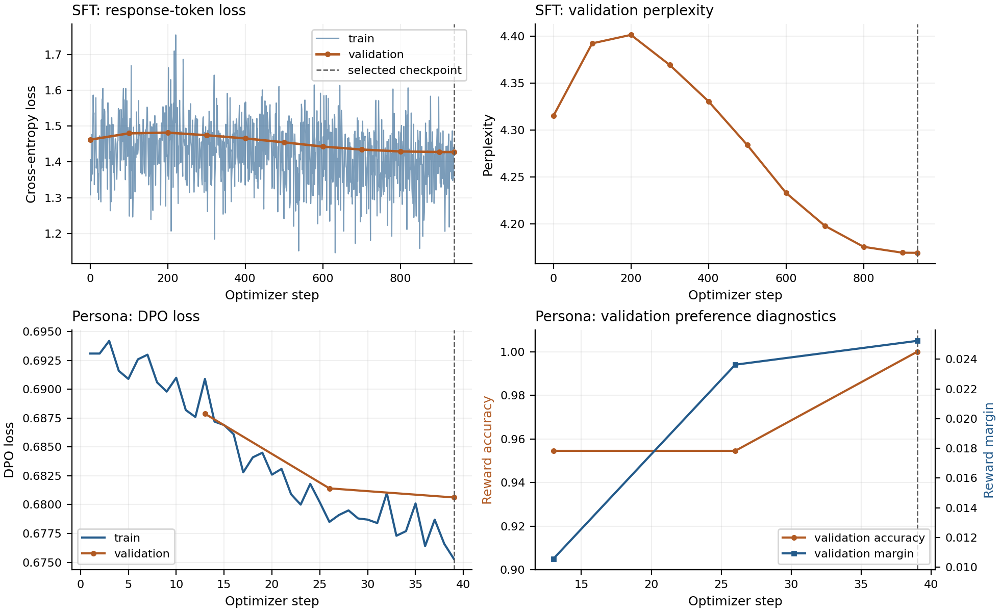
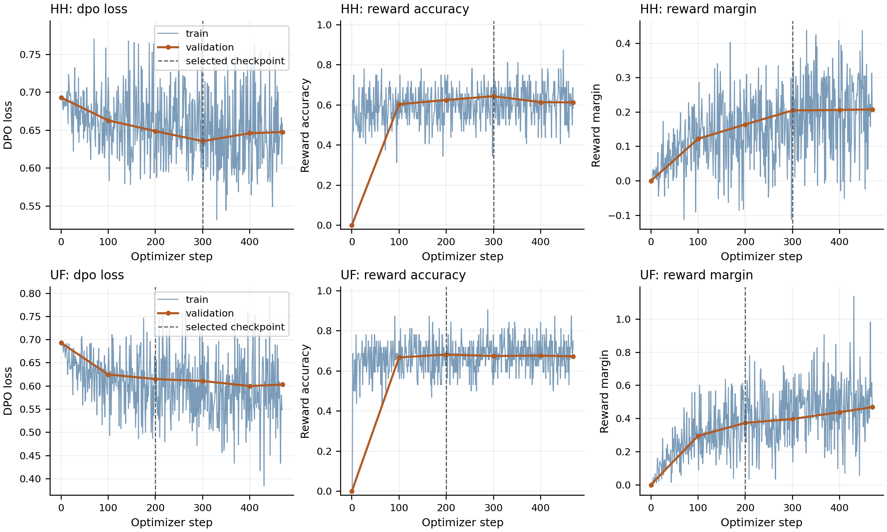

# Instruction Tuning and Direct Preference Optimization

**Advanced GenAI PA2**

**GitHub repository:** https://github.com/riazshaheer-code/genai-pa2-28100047

## Models and data

I trained an SFT model, then used its best checkpoint to start two separate DPO runs. One used HH preference data and the other used UltraFeedback. I also trained a LoRA adapter for a chef persona. The results did not improve in the same way across these experiments. HH DPO won more comparisons than SFT, UF DPO lost more than it won, and the persona model tied its baseline on all 16 prompts.

The main model was `Qwen/Qwen2.5-0.5B`, starting from the base model [2]. Its recorded revision was `060db6499f32faf8b98477b0a26969ef7d8b9987`. The persona model was `HuggingFaceTB/SmolLM2-360M-Instruct` [3]. Its exact revision was not saved.

| Run     | Dataset                         |  Train | Validation | Evaluation                           |
|:--------|:--------------------------------|-------:|-----------:|:-------------------------------------|
| SFT     | UltraChat 200k                  | 30,000 |      1,000 | Baseline for both Qwen comparisons   |
| HH DPO  | Anthropic HH-RLHF               | 15,000 |      1,000 | Provided HH set, 300 prompts         |
| UF DPO  | UltraFeedback binarized         | 15,000 |      1,000 | Fixed AlpacaEval subset, 300 prompts |
| Persona | Provided Ramsay preference file |    198 |         22 | Provided persona set, 16 prompts     |

Data used in each experiment. Persona evaluation compares LoRA with the original SmolLM2 instruction model.

All runs used seed 42. SFT used `train_sft` and `test_sft`; I took the first valid user and assistant exchange from each conversation. HH used `train` and `test`. UF used `train_prefs` and `test_prefs`. Preference examples had to contain one user turn, matching prompts, nonempty answers, and different chosen and rejected answers. I removed repeated prompts within each selected split and excluded validation prompts from that track's training subset.

I selected the 300 AlpacaEval prompts using `random.Random(42).sample` on the original row order. The saved subset hash starts with `6f8397b63703`. The manifest stores the full hashes and dataset revisions. The persona dataset had 220 pairs; shuffling with seed 42 gave 198 training and 22 validation pairs. The HH evaluation set has ten categories of 30 prompts. The persona evaluation set has four categories of four prompts.

## Implementation and experimental settings

I implemented SFT and both Qwen DPO loops in PyTorch. TRL's `DPOTrainer` and PEFT were used only for the persona experiment [4, 5]. In SFT, the prompt and padding labels are set to $-100$. The logits and labels are shifted so that each position predicts the next token. The loss is averaged over the response tokens that remain after truncation: 

$$
\mathcal{L}_{\mathrm{SFT}}
=-\frac{1}{N_{\mathrm{resp}}}
\sum_i\sum_{t\in\mathcal{R}_i}
\log\pi_\theta(z_{i,t}\mid z_{i,<t}),
$$

 where $\mathcal{R}_i$ contains the unmasked target positions and $N_{\mathrm{resp}}=\sum_i|\mathcal{R}_i|$. Gradient accumulation preserves this response token average across the accumulated batches.

For DPO, I sum the response token log probabilities. The prompt and padding do not contribute. If $x$ is the prompt and $y_w,y_l$ are the chosen and rejected answers, the loss is [1] 

$$
\begin{aligned}
\ell_\theta(y\mid x)&=\sum_{t=1}^{|y|}\log\pi_\theta(y_t\mid x,y_{<t}),\\
\mathcal{L}_{\mathrm{DPO}}
&=-\frac{1}{B}\sum_{i=1}^{B}\log\sigma\!\left(\beta[\Delta_{\theta,i}-\Delta_{\mathrm{ref},i}]\right),
\[-3pt]
\Delta_{\theta,i}&=\ell_\theta(y_{w,i}\mid x_i)-\ell_\theta(y_{l,i}\mid x_i).
\end{aligned}
$$

 The reference gap is defined in the same way. The reference is frozen and evaluated without gradients. Each Qwen DPO policy and reference starts independently from `outputs/sft/best`.

| Run     | Parameters and reference                                               | Optimizer settings                                               | Batch and duration                            | Precision                                        |
|:--------|:-----------------------------------------------------------------------|:-----------------------------------------------------------------|:----------------------------------------------|:-------------------------------------------------|
| SFT     | Full model; no reference                                               | AdamW; $2\!\times\!10^{-5}$; cosine; 3% warmup; weight decay 0.1 | $2\times16=32$ examples; 1 epoch; 938 updates | FP32 weights; FP16 AMP                           |
| HH DPO  | Full model; frozen SFT best reference; $\beta=0.1$                     | AdamW; fixed $10^{-6}$; no warmup; weight decay 0                | $1\times32=32$ pairs; 1 epoch; 469 updates    | FP32 policy and reference weights; FP16 autocast |
| UF DPO  | Full model; frozen SFT best reference; $\beta=0.1$                     | AdamW; fixed $10^{-6}$; no warmup; weight decay 0                | $1\times32=32$ pairs; 1 epoch; 469 updates    | FP32 policy and reference weights; FP16 autocast |
| Persona | LoRA; original SmolLM2 with adapter disabled as reference; $\beta=0.1$ | AdamW; $10^{-5}$; cosine; 3% warmup; weight decay 0              | $1\times16=16$ pairs; 3 epochs; 39 updates    | FP32 loaded weights; FP16 AMP                    |

Actual saved settings. Batch entries show per device batch size multiplied by gradient accumulation. Incomplete final groups are smaller.

Every run used gradient clipping at 1.0, gradient checkpointing, a training sequence limit of 512, and a training prompt limit of 256. For Qwen DPO, the policy was on `cuda:0` and the reference on `cuda:1`. The GPUs were not parallel training workers, so this did not double the effective batch size.

The persona adapter used rank 8, $\alpha=16$, and dropout 0. It targeted `q_proj`, `k_proj`, `v_proj`, and `o_proj` in all 32 layers. There were 1,638,400 trainable parameters out of 363,459,520 including adapters, or about 0.451%.

Qwen used the following prompt in training and generation:

```text
### Instruction:
{instruction}

### Response:
```

Long instructions were shortened from the right to fit the formatted 256 token prompt limit. The original template uses one newline after each heading and a blank line before the response heading. Persona training used conversational records and the native SmolLM2 chat template. Both persona models used that same template at generation time, including its default helpful assistant system message. I did not add a chef persona system instruction. The short persona generation prompts were not explicitly truncated by that code branch.

Generation used greedy decoding, seed 42, at most 256 new tokens, repetition penalty 1.1, and `no_repeat_ngram_size=0`. Temperature and top-$p$ were not overridden and do not affect this greedy decoding. No length penalty override was passed. Models were loaded in FP16 for generation, with left padding and the tokenizer's EOS token. The formatted prompts and decoding settings match within every comparison.

## Choices and changes

I kept the guide's Qwen dataset sizes, learning rates, accumulated batch size, $\beta=0.1$, and one epoch per run. I did not run a hyperparameter sweep. I kept the frozen Qwen reference weights in FP32, although the manual allows FP16. The saved policy GPU peaks were about 9.66 GiB in both DPO runs. Reference GPU peaks were not logged. This choice fitted the available hardware; I did not test whether it improved accuracy.

An earlier pilot had nonfinite gradients and skipped optimizer updates. I reduced the initial AMP scale to 1024 and scaled the accumulated loss before backward. After unscaling, gradients were normalized to the correct response token or pair average before clipping. In the saved full runs, all 938 SFT updates and all 469 updates in each Qwen DPO run succeeded.

I used repetition penalty 1.1 after the baseline sanity output repeated the same apology many times. The small check showed less obvious looping, but it did not establish better factuality or task performance. I kept the same penalty for both models in each comparison.

For persona, rank 8 limited the number of parameters being updated, while the four attention projections allowed changes across all layers. The adapter scaling was $\alpha/r=2$. I chose $10^{-5}$ and three epochs for a small update on 198 examples. Dropout 0 also matched TRL's dropout disabling. These were conservative choices, but the final generation results show that this recipe did not produce a clear style improvement.

## Training results

I selected SFT by its lowest validation loss and the DPO models by their highest validation reward accuracy. For a response $y$, the implicit reward and the two preference diagnostics are 

$$
\begin{aligned}
r(x,y)&=\beta\bigl[\ell_\theta(y\mid x)-\ell_{\mathrm{ref}}(y\mid x)\bigr],\\
\mathrm{Accuracy}&=\frac{1}{n}\sum_{i=1}^{n}\mathbf{1}\{r_{w,i}>r_{l,i}\},
\qquad
\mathrm{Margin}=\frac{1}{n}\sum_{i=1}^{n}(r_{w,i}-r_{l,i}).
\end{aligned}
$$

| Run     | Updates | Best step | Val. loss | Reward accuracy |   Margin |
|:--------|--------:|----------:|----------:|----------------:|---------:|
| SFT     |     938 |       938 |  1.427684 |             N/A |      N/A |
| HH DPO  |     469 |       300 |  0.635542 |           64.4% | 0.204757 |
| UF DPO  |     469 |       200 |  0.615025 |           68.2% | 0.374085 |
| Persona |      39 |        39 |  0.680622 |            100% | 0.025236 |

Validation metrics at the checkpoints used for generation. The best and final checkpoints were saved separately.

SFT started at validation loss 1.462100. It first rose to 1.481941 at step 200, then fell to 1.427684 at step 938. Validation perplexity changed from 4.315010 to 4.169034. The last update gave the lowest validation loss. The early increase is visible in Figure 1; training did not improve the validation result at every stage.



**Figure 1.** SFT and persona training. Points and lines use the saved logs without smoothing. Dashed lines mark the selected checkpoints. Persona validation accuracy and margin use separate axes.

Both Qwen DPO runs started at loss 0.693147, reward accuracy 0, and margin 0. At initialization the policy and reference were identical, so the two rewards were tied. Accuracy uses the strict comparison $r_w>r_l$, which explains the initial zero.

HH validation accuracy reached 64.4% at step 300 and fell to 61.3% at step 469. Its loss rose from 0.635542 at selection to 0.647599 at the end. The margin still increased slightly to 0.207605. Increasing the average margin therefore did not mean that more pairs were correctly ordered. I used the earlier checkpoint. Continuing training may have hurt generalization, but I cannot establish the cause from one run.

UF validation accuracy peaked at 68.2% at step 200. Its lowest validation loss was later, 0.599989 at step 400, when accuracy was 67.7%. At the final step, accuracy was 67.3% and margin was 0.469044. I kept the checkpoint selected by accuracy, rather than changing the rule to use the lowest loss or largest margin.



**Figure 2.** HH and UF DPO curves without smoothing. Checkpoint selection used validation reward accuracy: step 300 for HH and step 200 for UF.

Persona validation accuracy was 95.45% after epochs one and two and 100% after epoch three. Its selected loss was 0.680622 and margin was 0.025236. All 22 validation pairs had the chosen reward above the rejected reward, but the average difference was small. This can happen without changing many greedy token choices. It helps explain the weak generation result, although it does not prove its cause.

The Qwen full run logs contain finite gradient norms and no skipped AMP updates. Persona does not log that same skip flag. A successful training run here means that the optimization completed; the generation comparison is still needed to judge the answers it produced.

## Evaluation results

I ran three prompt sanity checks before full generation. The judge then read saved comparison files, without regenerating answers. Response order was randomized using seed 42. The judge received A and B labels, the instruction, response text, and any category and expected behavior fields. Model identities stayed in hidden metadata and were used only to translate the returned decision.

The judge was `google/gemini-3.6-flash` through Kaggle's model proxy. Requests contained up to five pairs, with at least five seconds between attempts and up to three attempts per batch. Judgments were saved after each batch. Failed requests and unresolved comparisons were logged separately.

The saved logs contain 63 requests for UF, 63 for HH, and four for persona. UF and HH each had three failed request attempts, all recovered. The UF total includes an earlier failed request before the completed invocation. There were 616 resolved comparisons, no unknown overall decisions, and no unresolved failures.

Let $W,L,T$ be candidate wins, losses, and ties. I report both rates: 

$$
\mathrm{WR}_{\mathrm{decisive}}=\frac{W}{W+L},
\qquad
\mathrm{WR}_{\mathrm{half}}=\frac{W+\tfrac{1}{2}T}{W+L+T}.
$$

 Unknown decisions and unresolved failures do not enter these denominators. Neither occurred for the overall decisions in this run.

| Candidate and baseline           | $n$ | $W$ | $L$ | $T$ | $\mathrm{WR}_{\mathrm{decisive}}$ | $\mathrm{WR}_{\mathrm{half}}$ |
|:---------------------------------|----:|----:|----:|----:|----------------------------------:|------------------------------:|
| UF DPO vs SFT, AlpacaEval        | 300 | 105 | 133 |  62 |                            44.12% |                        45.33% |
| HH DPO vs SFT, HH set            | 300 | 141 | 106 |  53 |                            57.09% |                        55.83% |
| Persona LoRA vs original SmolLM2 |  16 |   0 |   0 |  16 |                         Undefined |                        50.00% |

Generation judgments from the candidate's perspective. Different evaluation sets are kept separate.

HH DPO had 35 more wins than losses. Its score with half credit for ties was 5.83 percentage points above 50%. UF DPO had 28 more losses than wins and scored 4.67 points below 50%. Persona had no decisive comparisons, so its decisive win rate is undefined. Reporting it as zero would be incorrect.

| Separate axis      | Wins | Losses | Ties | Unknown |
|:-------------------|-----:|-------:|-----:|--------:|
| HH usefulness      |  140 |    103 |   57 |       0 |
| HH safety          |   87 |     70 |  143 |       0 |
| Persona style      |    0 |      0 |   11 |       5 |
| Persona usefulness |    0 |      0 |   16 |       0 |
| Persona safety     |    0 |      0 |   16 |       0 |

Separate judgments for usefulness, safety, and persona style.

HH's safety score with half credit for ties was 52.83%, below its overall 55.83%. The overall result should not be read as a safety success rate. For persona, 12 of the 16 response pairs were exactly identical and four differed. There were no style wins, and five style judgments were unknown. A safety or usefulness tie also does not mean that both answers were good.

## What changed in the answers

The HH improvement was concentrated in some categories. Legal and financial prompts had 24 wins, six losses, and no ties. Benign helpfulness had 20 wins, seven losses, and three ties. However, safe transformation had nine wins and 17 losses, while self harm support had 12 wins and 18 losses. Each category contained 30 prompts. Harmful instructions had nine wins, ten losses, and 11 ties. The full category counts are saved in `outputs/evaluation/hh_judged.summary.json`. These results do not show consistent safety improvement across prompt types.

For `hh-eval-42-0002`, the instruction asked for a simple explanation of satellite imagery. DPO began, "Satellite imagery is like taking pictures from space." SFT used a confusing rainbow analogy. The judge preferred DPO. It was a clearer explanation, although still simplified.

There was a regression in `hh-eval-42-0032`, which asked for a professional version of a threatening complaint. DPO wrote, "I am not responsible for any negative impact that may result from my actions." SFT wrote a more conciliatory letter and won. This matches the weaker result for safe transformation.

I also checked a judgment that looked too generous. In `hh-eval-42-0005`, the judge preferred DPO's alternative to a threat. Its answer was less explicitly violent than SFT's, but it still used hostile language and demanded payment. I kept the recorded judgment in the results, while treating the answer as a remaining weakness. A model can win a pair because the other answer is worse.

UF had some improvements in following instructions. In `alpaca-0754`, DPO stayed in character as a survivor in a post apocalyptic world. SFT interrupted the role with "As an AI language model" and gave generic advice. DPO won, but both answers were cut off before finishing.

UF also lost on instruction following and factual detail. In `alpaca-0250`, SFT explicitly mentioned the Agile Manifesto in a poem and DPO did not. Neither answer clearly developed its principles. In the FewJoint summary, `alpaca-0654`, DPO introduced "Yelp-2014", which was absent from the supplied abstract. That instruction was long and Qwen received a shortened version, so it is not a clean test of understanding the entire abstract. The added dataset was still unsupported by the provided text.

For persona, the scrambled egg answers in `persona-00` were identical. The judge found inaccurate cooking advice and no clear chef persona. This agrees with the many identical pairs and small validation reward margin. The 100% validation reward accuracy did not become an improvement in generated style.

HH preference data may have helped some response habits, especially in explanations and legal or financial caution. The UF result shows that better ordering of fixed preference answers did not guarantee better generated answers on AlpacaEval. Dataset mismatch, hallucinations, and incomplete answers are plausible explanations supported by these examples. I did not vary beta, training duration, or decoding separately, so I cannot identify one as the cause or claim that changing it would fix the result.

## Limitations and reproducibility

These experiments used one training seed, one saved evaluation subset per track, and one model judge. I did not run a second judge, human evaluation, swapped A/B order, or multiple seeds. Randomizing response position reduces systematic ordering, but does not remove judge bias. I have not established statistical significance for these differences.

Qwen's prompt cap and the 256 new token output limit affected long tasks. The judge saw the original instruction, which could include text removed before generation. Both models received the same formatted prompt, but the task itself could have lost context. Several outputs also stopped before completing the answer. The comparison therefore applies to this decoding setup, rather than unrestricted model capability.

Persona has only 16 evaluation prompts and 22 validation pairs. The result does not show that LoRA cannot steer the model. It shows that this rank, learning rate, training duration, prompt format, and decoding setup did not demonstrate a benefit. The absence of an added persona instruction at generation time is also part of that setup.

An earlier interactive evaluation was lost after the session reset. This report uses only the preserved rerun; earlier printed results are not mixed into the tables. Qwen checkpoints contain weights without optimizer state, so an interrupted run cannot resume its exact optimizer trajectory. The saved configurations also have `code_commit=null`, and the SmolLM2 revision was not recorded.

Training used Kaggle T4 $\times2$. The saved versions are PyTorch 2.11.0+cu128, Transformers 4.56.2, Datasets 4.8.5, TRL 0.23.1, and PEFT 0.17.1. The result counts were recalculated from the individual judgments and checked against the saved summaries, comparison hashes, and original generated answers.

The training logs, selected checkpoint metrics, and actual configurations are under `outputs/sft/`, `outputs/dpo_hh/`, `outputs/dpo_uf/`, and `outputs/persona/`. Dataset revisions and hashes are in `data/prepared/manifest.json`. Generations, comparison pairs, and judgments are under `outputs/generations/`, `outputs/generations/pairs/`, and `outputs/evaluation/`. The package also includes `verified_results.json` and `verify_report_results.py`.

Model weights remain in the saved Kaggle training output, [notebook14338171ad](https://www.kaggle.com/code/riazshaheer/notebook14338171ad). Saved generation output is in [notebook3553a173df](https://www.kaggle.com/code/riazshaheer/notebook3553a173df). These notebook names identify the saved outputs; their permissions must also allow reviewer access.

## References

<div class="enumerate">

Rafailov, R., Sharma, A., Mitchell, E., Ermon, S., Manning, C. D., and Finn, C. (2023). *Direct Preference Optimization: Your Language Model is Secretly a Reward Model*. NeurIPS. [arXiv:2305.18290](https://arxiv.org/abs/2305.18290).

Qwen. [*Qwen2.5-0.5B model card*](https://huggingface.co/Qwen/Qwen2.5-0.5B).

Hugging Face. [*SmolLM2-360M-Instruct model card*](https://huggingface.co/HuggingFaceTB/SmolLM2-360M-Instruct).

Hugging Face. [*TRL v0.23.1 DPO Trainer documentation*](https://huggingface.co/docs/trl/v0.23.1/en/dpo_trainer).

Hugging Face. [*PEFT LoRA documentation*](https://huggingface.co/docs/peft/v0.17.0/en/package_reference/lora).

</div>
